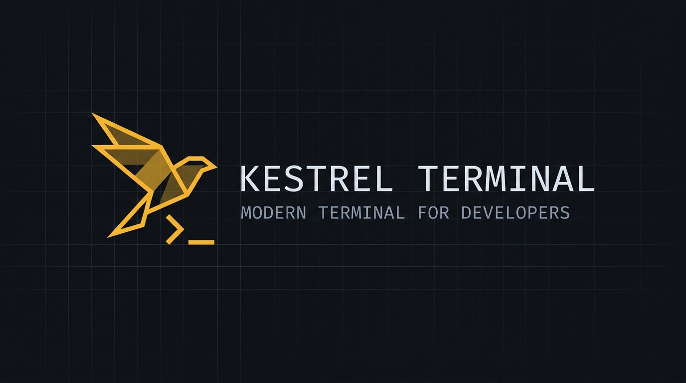
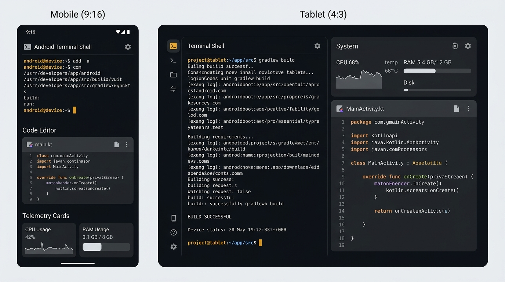

<div align="center">



# Kestrel Terminal

**Native Android Terminal, ARM64 Linux Workspace, Code Editor & Developer Suite**

[](.github/workflows/build-android.yml)
[-3DDC84?style=flat-square&logo=android&logoColor=black)](#apk-configuration)
[](#architecture)
[](LICENSE)
[](PRIVACY.md)

[Features](#core-capabilities) · [Screenshots](#workspace-preview) · [Architecture](#architecture) · [Build & CI](#building-from-source) · [APK Config](#apk-configuration) · [Privacy](PRIVACY.md) · [Security](SECURITY.md) · [License](LICENSE)

</div>

---

## Overview

**Kestrel** (`com.developer.terminal`) is a native Android terminal and all-in-one ARM64 development workspace built with **Kotlin**, **Jetpack Compose (Material 3)**, **NDK C/C++ JNI**, **Room SQLite**, and **Jetpack Glance**.

Instead of simulating shell commands, Kestrel spawns real interactive POSIX pseudoterminal (`PTY`) sessions via a compiled C++ JNI bridge (`libterminal_pty.so`) paired with bundled native ARM64 utilities (`libkestrel_utils.so`), Alpine `aarch64` package indexing, multi-tab syntax-highlighted editing, real hardware telemetry, developer tooling, and 7 resizable home-screen widgets.

---

## Workspace Preview



---

## Core Capabilities

| Module | Implementation Highlights |
| :--- | :--- |
| **PTY Terminal Engine** | Native C++ `openpty` / `fork` / `setsid` / `ioctl(TIOCSWINSZ)` JNI bridge; VT100/ANSI/xterm-256color & 24-bit truecolor parser; alternate screen buffer; multi-tab sessions; horizontal & vertical split panes; scrollback search; autocomplete; extra keys row; persistent `~/.kestrel_history` & `~/.kestrelrc`; foreground WakeLock service |
| **ARM64 Package Manager** | Syncs live Alpine Linux v3.20 `aarch64` `APKINDEX.tar.gz` mirrors; dependency resolution; live progress bar; safe canonical extraction into `$PREFIX`; install, remove, `upgradeAll`, custom repositories, and Room audit logs |
| **Multi-Tab Code Editor** | Syntax highlighting (Python, Kotlin, Java, JS/TS, C/C++, Shell), line numbers, auto-indentation, find & replace, workspace file explorer, SAF export, and direct **Run in Terminal** execution |
| **File Manager** | Browse `$HOME`, `$PREFIX`, and `/sdcard`; Android Storage Access Framework (`SAF`) folder import & file export; recursive search; text preview; ZIP compression/extraction; live storage usage indicator |
| **Android Telemetry** | Real `Build`, `/proc/cpuinfo`, per-core `cpufreq` MHz clocks, `ActivityManager` RAM, `StatFs` storage, `BatteryManager` %/temp/voltage/health, `WindowMetrics`, `ConnectivityManager` / `WifiManager`, Permissions Dashboard, and strictly opt-in `su` binary check |
| **Developer Suite** | OkHttp request tester, JSON formatter/validator, Markdown preview, on-device SQLite browser, localhost `ServerSocket` static HTTP server, `/proc/net/tcp` port scanner, JGit (`init`, `clone`, `status`, `commit`) + GitHub API, JSch SSH remote exec, project templates, JSON plugins, Room task scheduler, ZIP backup/restore, and optional user-key AI assistant |
| **7 Glance Widgets** | Resizable home-screen widgets: **Terminal Quick Launch**, **CPU & RAM Monitor**, **Battery Monitor**, **Storage Monitor**, **Running Tasks**, **Quick Commands**, and **Network Status** |
| **Responsive UI & Brand** | Custom adaptive/monochrome/notification icons, Android `SplashScreen` animated vector drawable, onboarding walkthrough, light/dark themes, 5 accent palettes, and adaptive `NavigationBar` (phones) / `NavigationRail` (tablets & landscape) |

---

## Architecture

```text
kestrel/
├── .github/workflows/
│   └── build-android.yml               # GitHub Actions CI: unit tests, APK/AAB build, apksigner verify
├── android/
│   ├── app/src/main/
│   │   ├── cpp/
│   │   │   ├── CMakeLists.txt          # Builds libterminal_pty.so & PIE libkestrel_utils.so
│   │   │   ├── terminal_pty.cpp        # POSIX PTY subprocess & window resize JNI bridge
│   │   │   └── kestrel_utils.c         # Native ARM64 sysinfo / tree / wc / which helpers
│   │   ├── java/com/developer/terminal/
│   │   │   ├── KestrelApplication.kt   # App-level dependency graph & repo bootstrap
│   │   │   ├── MainActivity.kt         # SplashScreen API + NavigationBar/NavigationRail shell
│   │   │   ├── data/                   # Room SQLite DAO/Entities & SharedPreferences settings
│   │   │   ├── terminal/               # PtyProcess, TerminalEmulator, ForegroundService, SessionManager
│   │   │   ├── packages/               # Alpine APKINDEX parser & $PREFIX extractor
│   │   │   ├── device/                 # Real Android hardware & sandbox permissions telemetry
│   │   │   ├── files/                  # File manager, ZIP archives, Storage Access Framework
│   │   │   ├── tools/                  # OkHttp, SQLite, JGit, JSch, HTTP server, Scheduler, Plugins
│   │   │   ├── widgets/                # 7 Jetpack Glance home-screen AppWidgets
│   │   │   └── ui/                     # Material 3 Theme + 8 Compose screens
│   │   └── res/                        # Adaptive/monochrome icons, AVD splash, widget XMLs
│   └── keystore/                       # Release signing properties (JKS ignored in git)
├── docs/images/                        # Documentation graphics & workspace previews
├── src/ & server.ts                    # Web artifact portal & source browser (port 3000)
├── LICENSE                             # Apache-2.0 License
├── PRIVACY.md                          # Offline-first privacy policy & permission matrix
├── SECURITY.md                         # Android W^X & ZipSlip security disclosures
└── CONTRIBUTING.md                     # Contributor setup & style guide
```

---

## APK Configuration

| Property | Value |
| :--- | :--- |
| **Application ID** | `com.developer.terminal` |
| **Version** | `1.0.0` (`versionCode = 1`) |
| **Minimum SDK** | Android 8.0 (`minSdk = 26`) |
| **Target / Compile SDK** | Android 15 (`targetSdk = 35`, `compileSdk = 35`) |
| **Native ABI** | `arm64-v8a` |
| **APK Signing** | v1 + v2 + v3 (`apksigner` verified) |

---

## Building from Source

### 1. Local Android Build (Android Studio or CLI)

Requirements: **JDK 17**, **Android SDK 35**, **Build Tools 35.0.0**, **NDK 27.2.12479018**, and **CMake 3.30.5**.

```bash
# Generate a local release signing keystore (skipped in git via .gitignore)
mkdir -p android/keystore
keytool -genkeypair -noprompt \
  -keystore android/keystore/kestrel-release.jks \
  -alias kestrel \
  -keyalg RSA -keysize 2048 -validity 10000 \
  -storepass kestrel2026release \
  -keypass kestrel2026release \
  -dname "CN=Kestrel Terminal, OU=Mobile Engineering, O=Kestrel Dev, L=San Francisco, ST=CA, C=US"

# Run unit tests and assemble Debug/Release APKs + AAB
cd android
./gradlew testDebugUnitTest assembleDebug assembleRelease bundleRelease
```

Verify the signed release APK and install via ADB on a physical ARM64 Android device:

```bash
$ANDROID_HOME/build-tools/35.0.0/apksigner verify --verbose android/app/build/outputs/apk/release/app-release.apk
adb install -r android/app/build/outputs/apk/release/app-release.apk
```

### 2. Automated GitHub Actions Build

Pushing or merging to `main` / `master` triggers [`.github/workflows/build-android.yml`](.github/workflows/build-android.yml), which automatically:

1. Sets up JDK 17, Android SDK 35, NDK 27, and CMake 3.30.5.
2. Runs `./gradlew testDebugUnitTest`.
3. Builds and signs `app-debug.apk`, `app-release.apk`, and `app-release.aab`.
4. Verifies signatures with `apksigner` and `aapt2 dump badging`.
5. Uploads `kestrel-android-artifacts` under the GitHub Actions run **Artifacts** tab.

---

## Documentation, Privacy & License

- **[Privacy Policy (`PRIVACY.md`)](PRIVACY.md)** — Zero analytics/telemetry, local sandbox data handling, user-initiated network map, and permission explanations.
- **[Security Policy (`SECURITY.md`)](SECURITY.md)** — W^X binary isolation, ZipSlip path canonicalization, localhost HTTP binding, and advisory reporting.
- **[Contributing Guide (`CONTRIBUTING.md`)](CONTRIBUTING.md)** — Setup, testing checklist, and Kotlin/C++ style rules.
- **[Apache-2.0 License (`LICENSE`)](LICENSE)** — Open-source licensing terms and conditions.
